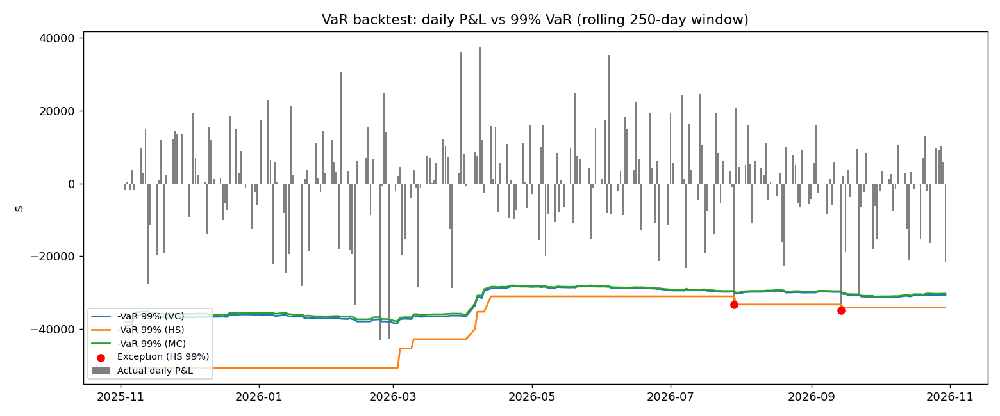

# Value at Risk (VaR): Three Methods and Backtesting

A from-scratch implementation of **Value at Risk** for an equally weighted portfolio of **JPMorgan (JPM), Morgan Stanley (MS) and Bank of America (BAC)**. It uses the three standard VaR methodologies plus a regulatory-style **backtest** (Basel Traffic Light and the Kupiec POF test).

Every model is built twice, in **Python** and in a fully formula-driven **Excel workbook**, so each number can be traced from raw prices to the final VaR.

| | |
|---|---|
| **Portfolio** | $1,000,000, equally weighted (1/3 each) in JPM, MS, BAC |
| **Data** | Yahoo Finance daily adjusted close, 2 years (31 Oct 2024 to 30 Oct 2026, 500 daily returns) |
| **Methods** | Variance-Covariance, Historical Simulation, Monte Carlo |
| **Confidence levels** | 90%, 95%, 99% (1-day horizon, scalable by √T) |
| **Backtest** | Rolling 250-day window, 250 out-of-sample days, Traffic Light and Kupiec POF |
| **Stack** | Python (pandas, NumPy, yfinance, matplotlib), Excel |

---

## Contents

1. [What is VaR?](#1-what-is-var)
2. [Why calculate it?](#2-why-calculate-it)
3. [Limitations of VaR](#3-limitations-of-var)
4. [Repository structure](#4-repository-structure)
5. [Common steps: data and returns](#5-common-steps-data-and-returns)
6. [Method 1: Variance-Covariance](#6-method-1-variance-covariance-parametric)
7. [Method 2: Historical Simulation](#7-method-2-historical-simulation)
8. [Method 3: Monte Carlo Simulation](#8-method-3-monte-carlo-simulation)
9. [Results and why the three answers differ](#9-results-and-why-the-three-answers-differ)
10. [Backtesting](#10-backtesting)
11. [How to run](#11-how-to-run)
12. [Key takeaways](#12-key-takeaways)
13. [Possible extensions](#13-possible-extensions)

---

## 1. What is VaR?

> **Value at Risk is the maximum loss a portfolio is expected not to exceed over a given time horizon, at a given confidence level, under normal market conditions.**

A statement such as *"1-day 99% VaR = $35,000"* means:

- On **99 out of 100** days, the portfolio should lose **less than $35,000**.
- On about **1 day in 100** (roughly 2 to 3 trading days a year), the loss is **expected to be worse** than $35,000.

Mathematically, VaR is a **quantile of the profit-and-loss (P&L) distribution**:

```
VaR_α  =  − (the (1 − α) quantile of the return distribution) × Portfolio Value
```

VaR is the *threshold* of the bad tail. It does **not** say how bad things get once that threshold is crossed (see [Limitations](#3-limitations-of-var)).

Every VaR number has three parameters, and the number is meaningless without them:

| Parameter | Meaning | Used here |
|---|---|---|
| **Confidence level** | How rare the loss event is (95%, 99%) | 90%, 95%, 99% |
| **Time horizon** | Length of the holding period | 1 day (scaled by √T for longer) |
| **Portfolio and data** | What is held, and what history describes it | $1M in JPM/MS/BAC, 2 years of daily data |

---

## 2. Why calculate it?

- **One number for risk.** It summarises the downside of a whole portfolio (many assets, correlations and all) in a single dollar figure that anyone can read.
- **Regulatory capital.** Under Basel, banks hold capital based on VaR (the market-risk capital charge is a multiple of 10-day 99% VaR), and the backtest results set that multiple. See [Backtesting](#10-backtesting).
- **Risk limits.** Trading desks and funds set VaR limits per desk, trader or strategy and monitor them daily.
- **Position sizing and capital allocation.** It shows which positions consume the most risk and how much diversification is really helping.
- **Comparability.** The same measure works across asset classes, desks and firms.
- **Reporting.** It is the standard language for risk committees, investors and regulators.

---

## 3. Limitations of VaR

VaR is useful but easy to misuse. These are the points an interviewer will probe.

1. **It says nothing about the tail beyond the threshold (tail risk).** A 99% VaR of $42k is equally true if the worst 1% of days lose $43k or $400k. VaR is the *entrance* to the tail, not a description of it. This project therefore also reports **Expected Shortfall (ES / CVaR)**, the average loss on the days worse than VaR. Basel's FRTB framework has moved from VaR to ES for this reason.
2. **Different methods give different answers.** There is no single "true" VaR. The result depends on the model and its assumptions (see [section 9](#9-results-and-why-the-three-answers-differ)).
3. **The normality assumption understates risk.** Real returns have **fat tails** (excess kurtosis) and are often skewed. In this dataset the equal-weighted portfolio has an **excess kurtosis of about 8.7** (a normal distribution has 0). The parametric 99% VaR is therefore too low.
4. **It depends on the history window.** A calm window gives a small VaR just before a crisis, and one crash keeps VaR high for the whole window and then drops out of it abruptly (visible in the backtest chart).
5. **Volatility and correlations are not constant.** In a crisis, correlations rise towards 1 and diversification disappears, which is exactly when VaR is needed.
6. **Not sub-additive.** VaR is not a *coherent* risk measure. The VaR of a combined portfolio can exceed the sum of its parts. ES is coherent.
7. **The √T rule assumes i.i.d. returns.** Scaling 1-day VaR to 10 days by √10 ignores volatility clustering and autocorrelation.
8. **Linear positions only (for the parametric method).** Options and other non-linear products need full revaluation (Monte Carlo or Historical).
9. **Past is not the future.** Every method here is calibrated on history. A truly new regime will not be in the data.
10. **Backtests have low power.** With 250 days at 99% you expect about 2.5 exceptions, which is too few to statistically separate a good model from a mediocre one.

---

## 4. Repository structure

```
value-at-risk-models/
├── README.md
├── VaR_Python/
│   ├── config.py            # Tickers, weights, portfolio value, horizon, confidence levels, seed
│   ├── data.py              # Steps 1-2: download prices (Yahoo Finance) and compute returns
│   ├── var_covariance.py    # Method 1: Variance-Covariance (parametric / delta-normal)
│   ├── var_historical.py    # Method 2: Historical Simulation (+ Expected Shortfall)
│   ├── var_monte_carlo.py   # Method 3: Monte Carlo with Cholesky (+ Expected Shortfall)
│   ├── backtest.py          # Rolling out-of-sample backtest, Traffic Light, Kupiec POF
│   ├── main.py              # Runs all three methods and prints a comparison table
│   ├── backtest_daily.csv   # Output: daily VaR forecasts and exceptions per method
│   ├── backtest_99.png      # Output: P&L vs 99% VaR chart
│   └── requirements.txt
└── VaR_Excel/
    └── VaR_Models_JPM_MS_BAC.xlsx   # Same models in live Excel formulas
```

**Excel workbook sheets:** `Summary` (comparison table), `Data` (prices and returns), `VarCov_Method`, `Historical_Method`, `MonteCarlo_Method` (10,000 scenarios in cells) and `Backtesting` (rolling-window VaR, exceptions, Kupiec and Traffic Light). All inputs (portfolio value, weights, holding period) are editable yellow cells.

To re-run with a different portfolio, change only `config.py`.

---

## 5. Common steps: data and returns

All three methods start the same way ([`data.py`](VaR_Python/data.py)).

**Step 1: Collect data.** Download daily **adjusted close** prices for JPM, MS and BAC from Yahoo Finance. Adjusted prices are corrected for dividends and splits so the returns are true total returns.

**Step 2: Calculate returns.** Use simple daily returns:

```
R_t = P_t / P_(t-1) − 1
```

The first day has no previous price and is dropped, so 501 prices give **500 daily returns**.

**Portfolio return** on a given day is the weighted sum of the stock returns:

```
R_p = w₁·R_JPM + w₂·R_MS + w₃·R_BAC        with w = (1/3, 1/3, 1/3)
```

### Data profile

| | JPM | MS | BAC |
|---|---|---|---|
| Mean daily return | 0.104% | 0.121% | 0.057% |
| Daily std dev | 1.551% | 1.938% | 1.583% |

**Correlation matrix** (high, so diversification helps only partly):

| | JPM | MS | BAC |
|---|---|---|---|
| **JPM** | 1.000 | 0.767 | 0.788 |
| **MS** | 0.767 | 1.000 | 0.772 |
| **BAC** | 0.788 | 0.772 | 1.000 |

---

## 6. Method 1: Variance-Covariance (parametric)

*Also called delta-normal. Code: [`var_covariance.py`](VaR_Python/var_covariance.py).*

**Idea:** Assume returns are normally distributed. Then the whole distribution is described by a mean and a standard deviation, and VaR follows from a z-score.

### Steps

| # | Step | Formula |
|---|---|---|
| 1-2 | Collect prices, compute returns | see [section 5](#5-common-steps-data-and-returns) |
| 3 | Mean and standard deviation of each stock | `μᵢ = mean(Rᵢ)`, `σᵢ = std(Rᵢ)` (sample, n−1) |
| 4 | Covariance matrix | `Σ` (3×3), sample covariance |
| 5 | Portfolio mean and volatility | `μₚ = wᵀμ`, `σₚ = √(wᵀ Σ w)` |
| 6 | Z-score for the confidence level | `Z = N⁻¹(CI)` → 1.2816 (90%), 1.6449 (95%), 2.3263 (99%) |
| 7 | VaR | `VaR = (Z·σₚ − μₚ) × V × √T` |

The term `wᵀΣw` is where **diversification** enters: because the stocks are not perfectly correlated, `σₚ` (1.559%) is lower than the weighted average of the individual volatilities (1.691%). The code reports this gap as a dollar **diversification benefit**.

### Assumptions
- Returns are **normally distributed**.
- Mean, volatility and correlations are **constant** over the window and horizon.
- Positions are **linear** (no options) and returns are i.i.d., so the √T rule applies.

### Pros and cons
| Pros | Cons |
|---|---|
| Simple, fast, closed-form | Normality ignores fat tails, so 99% VaR is usually **understated** |
| Diversification is explicit via the covariance matrix | Unsuitable for non-linear instruments |
| Easy to change confidence level or horizon, and to decompose risk by position | Covariance estimates are noisy and unstable |

---

## 7. Method 2: Historical Simulation

*Non-parametric. Code: [`var_historical.py`](VaR_Python/var_historical.py).*

**Idea:** Make no distributional assumption. Replay every past day as a possible scenario for today's portfolio and read VaR off the empirical distribution.

### Steps

| # | Step | Detail |
|---|---|---|
| 1-2 | Collect prices, compute returns | see [section 5](#5-common-steps-data-and-returns) |
| 3 | Portfolio return for every historical day | `R_p,t = Σ wᵢ·Rᵢ,t` (500 scenarios) |
| 4 | Sort from worst to best | the 5 worst days were −9.18%, −7.53%, −5.35%, −4.77%, −4.29% |
| 5 | Take the `(1 − CI)` percentile | e.g. the 1st percentile for 99% VaR |
| 6 | VaR | `VaR = −percentile × V × √T` |
| bonus | Expected Shortfall | average loss on the days at or beyond the VaR cut-off |

### Assumptions
- The historical window is **representative of the future**.
- Every historical day is **equally likely**.
- No distribution is assumed, so fat tails, skew and the real correlation structure are captured automatically.

### Pros and cons
| Pros | Cons |
|---|---|
| Intuitive, easy to explain to non-quants | Cannot see events that are not in the window |
| Captures fat tails, skew and actual correlations | **Few tail observations**: the 99% VaR rests on about 5 of 500 points, so it is noisy |
| Works for non-linear portfolios if you reprice each scenario | Slow to react to changes in volatility, and old shocks drop out suddenly |

---

## 8. Method 3: Monte Carlo Simulation

*Correlated multivariate normal. Code: [`var_monte_carlo.py`](VaR_Python/var_monte_carlo.py).*

**Idea:** Estimate parameters from history, then **simulate thousands of random but correlated scenarios** for the three stocks and read VaR from the simulated distribution.

### Steps

| # | Step | Detail |
|---|---|---|
| 1-2 | Collect prices, compute returns | see [section 5](#5-common-steps-data-and-returns) |
| 3 | Estimate the mean vector `μ` and covariance matrix `Σ` | from history |
| 4 | **Cholesky decomposition** `Σ = L Lᵀ` | `L` is the "square root" of the covariance matrix |
| 5 | Draw `N × 3` independent standard normals `Z`, then correlate: `R = μ + Z Lᵀ` | independent shocks become correlated returns |
| 6 | Portfolio return in each scenario | `R_p = Σ wᵢ·Rᵢ` (10,000 scenarios, `seed=42`) |
| 7 | VaR | `−(1−CI) percentile × V × √T`, plus Expected Shortfall |

**Sanity check built into the code:** the correlation matrix of the simulated returns (e.g. JPM-MS 0.772) matches the historical one (0.767), confirming the Cholesky step works.

### Assumptions
- Returns follow the chosen model (here multivariate normal) with parameters from history.
- Parameters are constant over the horizon.
- Enough simulations for the percentile to converge.

### Pros and cons
| Pros | Cons |
|---|---|
| Most flexible: swap in Student-t, GARCH, jump processes, options, path dependency | Computationally heavy |
| Produces the full P&L distribution (VaR, ES, any percentile) | Results vary with the random seed (sampling error) |
| Smooth tail estimate (10,000 points versus about 5 in the historical tail) | **Model risk**: with a normal model the answer is essentially the same as Variance-Covariance |

> **Honest note:** because this implementation draws from a *normal* distribution, Monte Carlo here is mostly a numerical re-derivation of Method 1 (the two are within about 2% of each other). Its real value appears when you replace the normal with a fat-tailed distribution or add non-linear instruments (see [extensions](#13-possible-extensions)).

---

## 9. Results and why the three answers differ

**1-day VaR on $1,000,000** (full 500-day sample):

| Confidence | Variance-Covariance | Historical | Monte Carlo |
|---|---|---|---|
| 90% | $19,045 | $17,263 | $18,912 |
| 95% | $24,710 | $23,941 | $24,944 |
| 99% | **$35,337** | **$42,714** | **$34,783** |

**Expected Shortfall (average loss beyond VaR):**

| Confidence | Historical ES | Monte Carlo ES |
|---|---|---|
| 90% | $28,403 | $26,397 |
| 95% | $36,849 | $31,161 |
| 99% | **$62,259** | $39,544 |

### Why different methods give different answers

1. **Normal versus real tails.** At 99%, Variance-Covariance and Monte Carlo (both normal) give about $35k, while Historical gives **$42.7k, about 21% higher**. The real data has fat tails (excess kurtosis 8.7, worst day −9.18%) that a normal curve cannot produce. The gap grows as the confidence level rises.
2. **The tail beyond VaR is much worse than VaR suggests.** The historical 99% **ES is $62k, about 46% above the 99% VaR**, whereas the normal-based Monte Carlo ES is only $39.5k. This is the tail-risk point from [section 3](#3-limitations-of-var) in numbers: VaR says "$42.7k", but when the line is crossed, the average loss is $62k.
3. **At 90% the order flips.** In the middle of the distribution the normal model, whose volatility is inflated by a handful of extreme days, is *more* conservative than the empirical distribution. Historical VaR is smallest at 90% ($17.3k).
4. **Monte Carlo ≠ Variance-Covariance exactly.** Both assume normality, so they are close, but Monte Carlo has random sampling error (10,000 draws, seed fixed for reproducibility). The simulated portfolio std dev is 1.578% versus the analytic 1.559%.
5. **Upside shocks count too (in the parametric model).** The largest move in the sample was a +10.5% day for the portfolio (6 Nov 2024). Standard deviation treats up and down moves symmetrically, so such days widen the normal curve even though they are gains.
6. **Sampling noise.** Historical VaR at 99% depends on about 5 data points, so it can swing sharply when one of them leaves the window.

**Rule of thumb:** none of the three is "correct". Practitioners compare them, and a large gap between parametric and historical VaR is itself a signal of fat tails.

---

## 10. Backtesting

A VaR model is only trustworthy if it is **right about how often it is wrong**. Backtesting checks whether the number of days on which the loss exceeded VaR (**exceptions** or **breaches**) is consistent with the confidence level. At 99% over 250 days, about 2.5 exceptions are expected.

Code: [`backtest.py`](VaR_Python/backtest.py). Daily output: [`backtest_daily.csv`](VaR_Python/backtest_daily.csv).

### Procedure

1. **Rolling window, out of sample.** For each of the 250 test days *t*, estimate VaR using **only the previous 250 days** (`t−250 … t−1`). No future data is used, so there is no look-ahead bias.
2. **Same three methods** are re-estimated every day: Variance-Covariance, Historical and Monte Carlo (common random numbers are reused, so day-to-day MC changes come from the data, not simulation noise).
3. **Flag exceptions.** `exception_t = 1` if the actual loss on day *t* exceeds that day's VaR.
4. **Count exceptions** per method and confidence level, and compare with the expected count `T × (1 − CI)`.
5. Apply **two tests**, below.

### Test A: Basel Traffic Light

Compute the cumulative binomial probability of seeing *at most x* exceptions if the model were correct, with `p = 1 − CI`:

| Zone | Cumulative probability | At 99% / 250 days | Meaning |
|---|---|---|---|
| 🟢 Green | < 95% | 0 to 4 exceptions | Model acceptable |
| 🟡 Yellow | 95% to 99.99% | 5 to 9 exceptions | Suspect. Regulator adds a capital **plus factor** (0.40 for 5, 0.50 for 6, 0.65 for 7, 0.75 for 8, 0.85 for 9) |
| 🔴 Red | ≥ 99.99% | 10+ exceptions | Model rejected, plus factor 1.00 |

Capital multiplier = 3 + plus factor.

### Test B: Kupiec Proportion-of-Failures (POF)

A formal likelihood-ratio test of whether the observed exception rate equals the expected rate `p`:

```
H₀: actual exception rate = p
LR = −2 ln[(1−p)^(T−x) · p^x]  +  2 ln[(1 − x/T)^(T−x) · (x/T)^x]   ~  χ²(1)
Reject H₀ if LR > 3.841 (5% significance), i.e. p-value < 0.05
```

It penalises **both** too many exceptions (model understates risk) and too few (model is overly conservative and ties up capital).

### Backtest results (250 days, 3 Nov 2025 to 30 Oct 2026)

| Method | CI | Expected | Actual | Rate | Kupiec LR | p-value | Kupiec @5% | Traffic light | Basel plus |
|---|---|---|---|---|---|---|---|---|---|
| Variance-Covariance | 90% | 25.0 | 24 | 9.60% | 0.045 | 0.832 | Accept | 🟢 Green | |
| Variance-Covariance | 95% | 12.5 | 15 | 6.00% | 0.496 | 0.481 | Accept | 🟢 Green | |
| Variance-Covariance | 99% | 2.5 | **5** | 2.00% | 1.957 | 0.162 | Accept | 🟡 **Yellow** | 0.40 |
| Historical | 90% | 25.0 | 31 | 12.40% | 1.498 | 0.221 | Accept | 🟢 Green | |
| Historical | 95% | 12.5 | 14 | 5.60% | 0.183 | 0.669 | Accept | 🟢 Green | |
| Historical | 99% | 2.5 | 2 | 0.80% | 0.108 | 0.742 | Accept | 🟢 Green | 0.00 |
| Monte Carlo | 90% | 25.0 | 26 | 10.40% | 0.044 | 0.834 | Accept | 🟢 Green | |
| Monte Carlo | 95% | 12.5 | 15 | 6.00% | 0.496 | 0.481 | Accept | 🟢 Green | |
| Monte Carlo | 99% | 2.5 | **5** | 2.00% | 1.957 | 0.162 | Accept | 🟡 **Yellow** | 0.40 |



*Grey bars are actual daily P&L. Lines are the (negative) 99% VaR forecasts. Red dots are Historical-VaR exceptions.*

### Reading the results

- **All nine model/confidence combinations pass the Kupiec test** at 5%, so none can be statistically rejected.
- **At 99%, the two normal-based methods (Variance-Covariance and Monte Carlo) get 5 exceptions against 2.5 expected, which puts them in the Basel Yellow zone.** This is the fat-tail problem showing up out of sample: the normal model underestimates how often extreme losses occur.
- **Historical 99% is Green (2 exceptions)**, consistent with it capturing fat tails. The chart shows why: its VaR is the *largest* of the three early in the test period (about $50k) because the big March and April 2025 selloff days are still inside the window, then **steps down** in March-April 2026 (to about $31k) as those days drop out. That abrupt window effect is the "ghost" behaviour of historical simulation.
- **Historical 90% shows 31 exceptions (12.4%) against 25 expected.** It is the least accurate at 90% in this sample, in line with the middle of the distribution being less well described by the empirical tail estimate.
- **Monte Carlo ≈ Variance-Covariance** in every row, again because both assume normality.
- **Caveat:** with only 250 test days and 2.5 expected exceptions at 99%, the tests have **low statistical power**. "Pass" does not mean "proven good". Kupiec also looks only at the *count* of exceptions, not their clustering or size (Christoffersen's independence test and ES backtests cover those).

---

## 11. How to run

### Python

```bash
git clone https://github.com/Madhav10Mahajan/value-at-risk-models.git
cd value-at-risk-models/VaR_Python
pip install -r requirements.txt
```

```bash
python3 main.py        # all three methods + comparison table
python3 backtest.py    # rolling backtest, Traffic Light, Kupiec; writes the CSV and PNG
```

Each method can be run on its own, for example `python3 var_historical.py`. Edit `config.py` to change tickers, weights, portfolio value, holding period, confidence levels, lookback window, number of simulations or the seed.

> **Note:** prices are downloaded live from Yahoo Finance, so the rolling 2-year window moves forward each day and a fresh run will give numbers slightly different from the snapshot above (31 Oct 2024 to 30 Oct 2026). The Excel workbook contains that exact snapshot of prices.

### Excel

Open `VaR_Excel/VaR_Models_JPM_MS_BAC.xlsx`. Start at the `Summary` sheet. Every figure is a live formula, so changing the yellow input cells (portfolio value, weights, holding period) updates the results. In the Monte Carlo sheet, press **F9** to redraw the random scenarios and watch the simulation noise.

---

## 12. Key takeaways

- VaR answers *"how much could I lose on a bad (but not catastrophic) day?"* It does **not** answer *"how bad can it get?"*
- Three methods, three trade-offs: **speed and transparency** (Variance-Covariance), **realism with no assumptions** (Historical), **flexibility** (Monte Carlo).
- On this portfolio, **normality understates 99% risk**: parametric $35k versus historical $43k, and the normal-based models land in the Basel Yellow zone in the backtest.
- The **tail beyond VaR is much heavier** than VaR suggests (99% ES of $62k versus VaR of $43k), which is why the industry is moving to **Expected Shortfall**.
- A model is not finished until it is **backtested**: forecast out of sample, count exceptions, and test them formally.

---

## 13. Possible extensions

- Replace the normal with a **Student-t** or a **GARCH / EWMA** volatility model for fat tails and volatility clustering.
- **Filtered Historical Simulation** or **age-weighted** historical VaR (e.g. BRW) to fix the slow-reaction problem.
- Add **Christoffersen's independence and conditional coverage tests** for exception clustering.
- **Expected Shortfall backtesting** (Acerbi-Szekely).
- **Stress testing and scenario analysis** (for example a 2008-style shock) alongside VaR.
- **Component / marginal VaR** to decompose risk by position.
- Extend to **options and non-linear products** through full revaluation in the Monte Carlo engine.

---

*Disclaimer: this project is for educational and portfolio demonstration purposes only and is not investment advice.*
